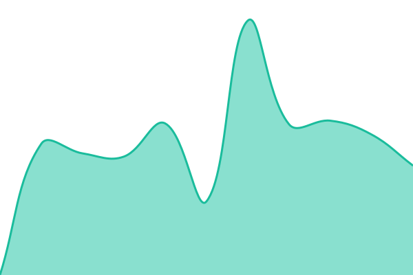
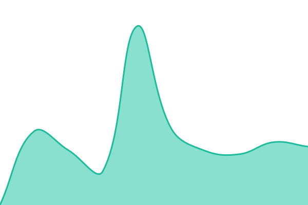

# [📈 Live Status](https://status.nbetray.cn): <!--live status--> **🟩 All systems operational**

This repository contains the open-source uptime monitor and status page for [Nbetray](https://status.nbetray.cn), powered by [Upptime](https://github.com/upptime/upptime).

With [Upptime](https://upptime.js.org), you can get your own unlimited and free uptime monitor and status page, powered entirely by a GitHub repository. We use [Issues](https://github.com/Nbetray/status/issues) as incident reports, [Actions](https://github.com/Nbetray/status/actions) as uptime monitors, and [Pages](https://status.nbetray.cn) for the status page.

<!--start: status pages-->
<!-- This summary is generated by Upptime (https://github.com/upptime/upptime) -->
<!-- Do not edit this manually, your changes will be overwritten -->
<!-- prettier-ignore -->
| URL | Status | History | Response Time | Uptime |
| --- | ------ | ------- | ------------- | ------ |
|  [源站](https://www.host.nbetray.cn/) | 🟩 Up | [源站.yml](https://github.com/Nbetray/status/commits/HEAD/history/源站.yml) | 

 1028ms
     
 | 

<a href="https://status.nbetray.cn/history/源站">100.00%</a>
    

|  [Live 2d](https://live2d.nbetray.cn/readyz) | 🟩 Up | [live-2d.yml](https://github.com/Nbetray/status/commits/HEAD/history/live-2d.yml) | 

 1037ms
     
 | 

<a href="https://status.nbetray.cn/history/live-2d">100.00%</a>
    

|  [主站](https://www.nbetray.cn/) | 🟩 Up | [主站.yml](https://github.com/Nbetray/status/commits/HEAD/history/主站.yml) | 

 6181ms
     
 | 

<a href="https://status.nbetray.cn/history/主站">100.00%</a>
    

|  [Hook Forward](https://hookforward.nbetray.cn/healthz) | 🟩 Up | [hook-forward.yml](https://github.com/Nbetray/status/commits/HEAD/history/hook-forward.yml) | 

 961ms
     
 | 

<a href="https://status.nbetray.cn/history/hook-forward">100.00%</a>
    

|  [Sub Converter](https://subconverter.nbetray.cn/version) | 🟩 Up | [sub-converter.yml](https://github.com/Nbetray/status/commits/HEAD/history/sub-converter.yml) | 

 265ms
     
 | 

<a href="https://status.nbetray.cn/history/sub-converter">100.00%</a>
    

|  [Minio](https://minio.nbetray.cn/minio/health/live) | 🟩 Up | [minio.yml](https://github.com/Nbetray/status/commits/HEAD/history/minio.yml) | 

 381ms
     
 | 

<a href="https://status.nbetray.cn/history/minio">100.00%</a>
    

|  [Headlamp](https://headlamp.nbetray.cn/) | 🟩 Up | [headlamp.yml](https://github.com/Nbetray/status/commits/HEAD/history/headlamp.yml) | 

 923ms
     
 | 

<a href="https://status.nbetray.cn/history/headlamp">100.00%</a>
    

|  [Prometheus](https://prometheus.nbetray.cn/-/ready) | 🟩 Up | [prometheus.yml](https://github.com/Nbetray/status/commits/HEAD/history/prometheus.yml) | 

 925ms
     
 | 

<a href="https://status.nbetray.cn/history/prometheus">100.00%</a>
    

|  [Grafana](https://grafana.nbetray.cn/api/health) | 🟩 Up | [grafana.yml](https://github.com/Nbetray/status/commits/HEAD/history/grafana.yml) | 

 915ms
     
 | 

<a href="https://status.nbetray.cn/history/grafana">100.00%</a>
    

|  [Jmcomic Syncer API](https://jmcomic-syncer.nbetray.cn/) | 🟩 Up | [jmcomic-syncer-api.yml](https://github.com/Nbetray/status/commits/HEAD/history/jmcomic-syncer-api.yml) | 

 856ms
     
 | 

<a href="https://status.nbetray.cn/history/jmcomic-syncer-api">100.00%</a>
    

|  [Muscriptor](https://muscriptor.nbetray.cn/) | 🟩 Up | [muscriptor.yml](https://github.com/Nbetray/status/commits/HEAD/history/muscriptor.yml) | 

 866ms
     
 | 

<a href="https://status.nbetray.cn/history/muscriptor">100.00%</a>
    

|  [Static Page](https://staticpage.nbetray.cn/) | 🟩 Up | [static-page.yml](https://github.com/Nbetray/status/commits/HEAD/history/static-page.yml) | 

 754ms
     
 | 

<a href="https://status.nbetray.cn/history/static-page">100.00%</a>
    

|  [Portal](https://portal.nbetray.cn/) | 🟩 Up | [portal.yml](https://github.com/Nbetray/status/commits/HEAD/history/portal.yml) | 

 975ms
     
 | 

<a href="https://status.nbetray.cn/history/portal">100.00%</a>
    

|  [File](https://file.nbetray.cn/) | 🟩 Up | [file.yml](https://github.com/Nbetray/status/commits/HEAD/history/file.yml) | 

 1403ms
     
 | 

<a href="https://status.nbetray.cn/history/file">100.00%</a>
    

|  [3X UI](https://3xui.nbetray.cn/) | 🟩 Up | [3-x-ui.yml](https://github.com/Nbetray/status/commits/HEAD/history/3-x-ui.yml) | 

 204ms
     
 | 

<a href="https://status.nbetray.cn/history/3-x-ui">100.00%</a>
    

|  [Minio Browser](https://browser.minio.nbetray.cn/) | 🟩 Up | [minio-browser.yml](https://github.com/Nbetray/status/commits/HEAD/history/minio-browser.yml) | 

 224ms
     
 | 

<a href="https://status.nbetray.cn/history/minio-browser">100.00%</a>
    

|  [Harbor.nbetray.cn](https://harbor.nbetray.cn/api/v2.0/health) | 🟩 Up | [harbor-nbetray-cn.yml](https://github.com/Nbetray/status/commits/HEAD/history/harbor-nbetray-cn.yml) | 

 1007ms
     
 | 

<a href="https://status.nbetray.cn/history/harbor-nbetray-cn">100.00%</a>
    

|  [Frp](https://frp.nbetray.cn/) | 🟩 Up | [frp.yml](https://github.com/Nbetray/status/commits/HEAD/history/frp.yml) | 

 1042ms
     
 | 

<a href="https://status.nbetray.cn/history/frp">100.00%</a>
    

|  [API](https://api.nbetray.cn/poetize/webInfo/getWebInfo) | 🟩 Up | [api.yml](https://github.com/Nbetray/status/commits/HEAD/history/api.yml) | 

 941ms
     
 | 

<a href="https://status.nbetray.cn/history/api">100.00%</a>
    

|  [All In SSL](https://allinssl.nbetray.cn/login) | 🟩 Up | [all-in-ssl.yml](https://github.com/Nbetray/status/commits/HEAD/history/all-in-ssl.yml) | 

 778ms
     
 | 

<a href="https://status.nbetray.cn/history/all-in-ssl">100.00%</a>
    

<!--end: status pages-->

[**Visit our status website →**](https://status.nbetray.cn)

## 📄 License

- Powered by: [Upptime](https://github.com/upptime/upptime)
- Code: [MIT](./LICENSE) © [Anand Chowdhary](https://anandchowdhary.com)
- Data in the `./history` directory: [Open Database License](https://opendatacommons.org/licenses/odbl/1-0/)
